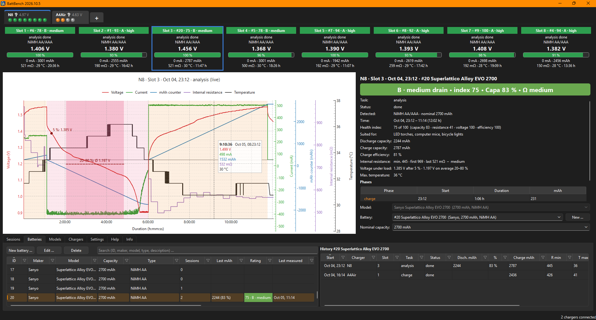

# BattBench

**Battery test bench for your PC: track every rechargeable cell over its whole life and see how it ages.**

[](docs/screenshot.png)

*Two chargers with twelve slots live, each slot with its battery and rating; the chart of a capacity test with the
plateau of the discharge marked, its health index and the history of the battery.*

BattBench reads ISDT and SkyRC chargers over **USB**, **Bluetooth** or a
**[BattBench-ESP](https://github.com/fashberg/battbench-esp)** bridge, records their readings, detects charge and
discharge runs, rates each battery against its nominal capacity and keeps a **history per battery**. Several chargers
can be connected at the same time.

The user interface is available in **English** and **German**. The user guide below is also built into the app
(tab *Help*).

## Why this app?
I have loved my ISDT N8 for years, but one thing always bugged me: the result of the analysis. I want to see how much
capacity my batteries have left, yet as soon as discharging is done, that number is gone from the display.

Thanks to the [isdttool](https://github.com/maxried/isdttool) library by [maxried](https://github.com/maxried), I was
able to write a "works for me" battery analysis tool together with Claude Opus 5.5 in no time. It listens in on the
charger over USB and logs everything for me – and on top of that keeps a database of all my batteries.

## Features
- **Live view** of every slot of every connected charger: mode, voltage, current, mAh, internal resistance,
  temperature, progress.
- **One chart per run** with voltage, current, mAh, internal resistance and temperature, each on its own axis.
- **Session reports** as an HTML page or a PDF: rating, battery, charger, chart and every phase.
- **Automatic session detection**, also across restarts of the app.
- **Rating**: a health index from capacity, internal resistance, voltage under load and charge efficiency, with a
  category (A high drain … D recycle) and what the cell is still good for.
- **Battery tracking**: a number per cell and its whole history, across chargers and slots.
- **Battery models** with nominal capacity; a list of common cells is included.
- **SkyRC MC5000**
  - **Charge profiles**: configure charging profiles and control the charger – start and stop slots, change its
    settings.
  - **[BattBench-ESP](https://github.com/fashberg/battbench-esp)**: adds Wi-Fi to the charger with a microcontroller
    for about 10 € and buffers the readings while the PC is off.
- Spreadsheet-like filters on all tables, light and dark Windows theme.

## Supported chargers
| Charger | Slots | Power | Data connection | Discharge / analysis | Tested |
|---|---|---|---|---|---|
| ISDT **N8** | 8 | USB-C – from a PC too little, see *Power supply* | USB | yes | ✔ |
| ISDT **A4 Air** | 4 | USB-C (older models: micro-USB) – from a PC too little, see *Power supply* | Bluetooth (recommended) or USB | no | ✔ |
| SkyRC **MC5000** | 4 | mains | Bluetooth of the PC, or a BattBench-ESP | yes | ✔ |
| SkyRC MC3000 | 4 | DC | Bluetooth of the PC, or a BattBench-ESP | yes | – |
| ISDT N16 / N24 | 16 / 24 | DC | USB | yes | – |
| ISDT C4 | 4 | DC | USB | yes | – |
| ISDT C4 Air | 6 | USB-C – from a PC too little, see *Power supply* | Bluetooth | no | – |
| ISDT C4 EVO | 4 | USB-C – from a PC too little, see *Power supply* | USB | yes | – |
| ISDT UC4 | 4 | see the charger's manual | USB | yes | – |
| ISDT A8 Air | 8 | USB-C (older models: micro-USB) – from a PC too little, see *Power supply* | Bluetooth | no | – |

Chargers marked “–” are supported by protocol but have not been tried on real hardware yet.

- **USB**: the charger is read while it is plugged into the PC; BattBench must be running.
- **Bluetooth of the PC**: no cable, but a charger takes only one Bluetooth connection – close its phone app.
  BattBench must be running.
- **[BattBench-ESP](https://github.com/fashberg/battbench-esp)**: an ESP32-S3 at the charger (powered from its USB-C
  output) holds the Bluetooth connection, **buffers** the readings for months while the PC is off, and passes
  BattBench's charger control through (profiles, start / stop, settings).

```
         mains power (MC3000: DC)
                   │
                   ▼
        ┌──────────────────────┐
        │    SkyRC MC5000      │
        │   (or MC3000)        │
        └──────────────────────┘
           ▲               │
           │ Bluetooth LE  │ USB-C power output
           │ (status,      │ (power only, no data)
           │  commands)    ▼
        ┌──────────────────────┐
        │   ESP32-S3           │
        │   BattBench-ESP      │
        │   data buffer        │
        └──────────────────────┘
                   ▲
                   │ Wi-Fi (HTTP, mDNS)
                   ▼
        ┌──────────────────────┐
        │   BattBench          │
        │   (Windows / Mac)    │
        │   charts, analysis   │
        └──────────────────────┘
```

## Installation
For the BattBench-ESP see its separate repository: [battbench-esp](https://github.com/fashberg/battbench-esp).

### Windows
Download `BattBench-<version>-setup.exe` from the [releases](https://github.com/fashberg/battbench/releases) and run
it. It installs for the current user (no
administrator rights needed), adds BattBench to the Start menu and, if you like, to the desktop. Uninstalling asks
whether to keep your measurements.

### From source (Windows, Linux, macOS)
Requires Python 3.10 or newer.
```
git clone https://github.com/fashberg/battbench.git
cd battbench
run.bat          (Windows)
./run.sh         (Linux / macOS)
```
The first start creates a virtual environment in `.venv` and installs the requirements. On Linux, USB access to the
chargers needs a udev rule for the ISDT USB id, e.g. `/etc/udev/rules.d/70-isdt.rules`:
```
SUBSYSTEM=="hidraw", ATTRS{idVendor}=="28e9", ATTRS{idProduct}=="028a", TAG+="uaccess"
```

### Command line options
| Option | Effect |
|---|---|
| `--offline` | only view the database, no chargers |
| `--db FILE` | use another database file (or set the environment variable `BATTBENCH_DB`) |
| `--lang auto\|en\|de` | user interface language (also in the app, tab *Settings*) |
| `--a4 usb\|bt\|both` | how the A4 Air is read (also in the app, tab “+”) |
| `--no-bt` | no Bluetooth at all |
| `--debug` | detailed log: every unanswered query (also printed to the console) |

<!-- help: everything up to the end marker is also the built-in help (tab Help); keep help_de.md in step -->
## User guide

### What BattBench does
BattBench turns your charger into a battery test bench. It reads every slot of every connected charger once a second
and stores a reading every 10 seconds (every change of task or current direction at once). From these readings it recognises **sessions** – one task of one battery in one slot, from
inserting it until it is taken out or another task starts – with their charge and discharge **phases**. A session
that measured a discharge gets a **rating**. If you give your batteries **numbers**, every session can be assigned
to its battery, and you see how each cell ages over the months.

ISDT chargers are only read: start, stop and settings are done on the charger as usual. A SkyRC MC5000 can also
be controlled from BattBench (see *Profiles and charger control*).

### Before you start
- Close the official **ISD Go** updater: it opens the chargers over USB exclusively.
- Quit the phone app – **ISD Link** for ISDT Air chargers, the **SkyRC** app for the MC3000 / MC5000 – or switch off
  Bluetooth on the phone. A Bluetooth charger accepts only one connection and is invisible to others while the phone
  is connected.
- Chargers powered over USB (e.g. the N8): see *Power supply* below.

### Power supply
A charger powered over USB (ISDT N8, C4 EVO, A4 Air, A8 Air, C4 Air – also when BattBench reads it over Bluetooth) gets
**too little power** from a PC or laptop: their USB ports supply 5 V at 0.5–1.5 A (at most 10 W), without USB Power Delivery. The
N8 then charges with only about 100 mA per slot once about four slots charge (discharging is not affected); an
analysis of 8 cells can take two days.
- **USB-C hubs** that pass USB Power Delivery on to a *device* port are rare and expensive.
- Most **power injectors** and PD hubs charge the *host* – that is the PC, not the charger.
- Charging with 5 V / 10 W stays slow, whatever cable you use.

Chargers with a mains or DC supply are not affected, and a SkyRC MC5000 needs no cable to the PC at all (Bluetooth or
a BattBench-ESP).

### Numbering batteries and models
- Write a **number** on each cell (e.g. with a paint marker) and create it in the tab *Batteries* with *New battery …*
  using the same number. *Count* creates several identical batteries with consecutive numbers at once.
- Choose the **model** (e.g. “Panasonic eneloop pro AA”): it supplies maker, type and **nominal capacity**. Typing in
  the list filters it, e.g. “ene pro aa”. BattBench comes with a list of common cells; add your own in the tab
  *Models* or with *New …* in the battery dialog. Changing a model updates all its batteries and rates their
  sessions again.
- A battery without a model gets maker, type and capacity typed in by hand.

### Measuring
1. Insert the battery and start a task on the charger. A capacity is measured by **analysis** (charge – discharge –
   charge), **discharge** or **cycle**; a plain charge gives no capacity.
2. Click the slot tile: the chart and the result panel show the running session.
3. In the result panel choose the **battery** (or first the model to narrow the list). Every change is saved at once.
   Without a battery, pick a model or type the **nominal capacity** (suggestions 500–3000 mAh, any value can be
   typed). A **note** (e.g. “new contacts”) is kept with the session and shown in the session lists.
4. When the discharge is over, the session is rated. While it is still running the panel shows e.g.
   “analysis running”.

The N8 does not tell AA from AAA, so its sessions are only rated once a battery, model or nominal capacity is set.

### The values
- **Discharge capacity** – what the battery delivered during the (last) discharge. Compared with the nominal
  capacity it gives the rating.
- **Charge capacity** – what was put in after the discharge. It is higher than the discharge capacity because
  charging has losses; discharge ÷ charge is the charge efficiency (typically 70–90 % for NiMH).
- **Internal resistance** – as the charger measures it; **lower is better**. It rises with age and wear, and a high
  value lets the voltage drop under load. The chargers include the contact resistance, so the values are higher than
  those of a dedicated meter. *min.* is the lowest value of the session, first and last the values at its start and
  end.
- **Temperature** – the highest temperature of the session. NiMH cells get warm towards the end of charging; above
  about 45 °C the cell is stressed.
- **Status** – *running* (with *charging* / *discharging*), *done*, *removed* (taken out before the end) or *aborted*
  (stopped, replaced by another task, or the data broke off).

### Rating
A session that measured a discharge (analysis, discharge, cycle) gets a **health index** from 0 to 100 and from it a
**category**. The index is made of four scores of 0–100 each:

| Score | Weight | From |
|---|---|---|
| Capacity | 40 % | discharge capacity in % of the nominal capacity |
| Internal resistance | 30 % | lowest internal resistance of the session |
| Voltage under load | 20 % | voltage curve of the (last) discharge |
| Charge efficiency | 10 % | discharge capacity ÷ the charge put in after it |

**Capacity** – SoH = discharge capacity ÷ nominal capacity × 100:

| SoH | Score |
|---|---|
| from 90 % | 100 |
| 70–90 % | 100 − (90 − SoH) × 2.5, i.e. 50 … 100 |
| 50–70 % | 50 − (70 − SoH) × 2, i.e. 10 … 50 |
| below 50 % | 0 |

**Internal resistance** – as the charger measures it. Contacts and leads are included, so a healthy NiMH AA shows
about 150–220 mΩ on an N8 where a 4-wire meter shows 20–30 mΩ. The usual steps for 4-wire values (30 / 60 / 120 /
250 mΩ) are therefore moved to the charger scale; in between the score falls in a straight line:

| NiMH / NiCd / NiZn | Li-ion / LiFePO4 | Score | Shown as |
|---|---|---|---|
| below 150 mΩ | below 50 mΩ | 100 | very good |
| 150–300 mΩ | 50–100 mΩ | 100 → 75 | good |
| 300–450 mΩ | 100–150 mΩ | 75 → 40 | medium |
| 450–600 mΩ | 150–200 mΩ | 40 → 0 | poor |
| from 600 mΩ | from 200 mΩ | 0 | very poor |

**Voltage under load** (NiMH) – from the readings of the last discharge. The positions are fractions of the charge
taken out (added up from the current), so a slow end of the discharge doesn't shift them:
- *V5* = voltage after 5 %: below 1.15 V costs (1.15 V − V5) × 200 points,
- *Vmid* = average voltage from 20 to 80 % (the plateau): below 1.20 V costs (1.20 V − Vmid) × 150 points,
- *early drop* = below 1.0 V before 80 %: costs 30 points.

Score = 100 minus these points (at least 0). The limits hold for a discharge current of about 0.2 C (about 500 mA for
an AA, the current of the N8). The chart shades the plateau of the last discharge darker and marks both values.

**Charge efficiency** – η = discharge capacity ÷ charge put in after the discharge; it counts once that charge is
finished:

| η | Score |
|---|---|
| 75–85 % | 100 (normal for NiMH) |
| 65–75 % | 100 − (75 − η) × 3 |
| below 65 % | 70 − (65 − η) × 4, at least 0 (losses, heat) |
| above 85 % | 50 (the charge may have ended early) |

The N8 often reports a charge only a little above the discharge (90–100 %); with a weight of 10 % this costs at most
5 points.

**Health index** = 0.4 × capacity + 0.3 × resistance + 0.2 × voltage + 0.1 × efficiency. A score that can't be worked
out is left out and the weights of the others scaled up to 100 %: no charge after the discharge (task *discharge*, or
still charging), no voltage curve, no resistance – or only an estimated one: the A4 Air over USB reports none,
BattBench estimates it from its charging pauses (≈ in the slot tile) and doesn't rate it.

| Category | Condition | Suited for |
|---|---|---|
| A · high drain | index from 85 and resistance below 300 mΩ (Li-ion: 100 mΩ) | flash units, RC models, motorised toys |
| B · medium drain | index 70–85 | LED torches, computer mice, bicycle lights |
| C · low drain | index 50–70 | remote controls, wall clocks, solar lights |
| D · recycle | index below 50, capacity below 70 % or resistance score 0 | no longer usable |

The tables show the rating as index · category, e.g. *98 · A · high*, and sort by the index (best first on the first
click); the slot tiles show it behind the battery, e.g. *Slot 4 – #5 · 78 · B · medium*.

Without a nominal capacity there is no rating (assign the battery or enter it). A cell without a capacity
measurement but with a very high resistance (from 1000 mΩ NiMH / 400 mΩ Li-ion) is marked *suspicious*. Sessions
measured with an older version are evaluated from their stored readings when the app starts.

The limits follow IEC 61951-2 (end of discharge at 1.0 V at 0.2 C, charge efficiency of NiMH), the data sheets of
Panasonic eneloop, GP and Varta (internal resistance) and the 80 % / 50 % capacity limits of chargers like the SkyRC
MC3000 and Maha MH-C9000.

### Using the app

#### Charger tabs and tiles
- **Tabs** at the top: name, input voltage, connection symbol and one LED per slot – grey empty, orange ready (battery
  in, no task), yellow charging, red discharging, blue analysis / activation / cycle, green done, blinking red error.
  The "+" tab lists the supported chargers and the connection settings.
- **Tiles**: values and state of each slot. Click a tile to see its session and, if a battery is assigned, its
  history.
- **Offline**: a charger that is unplugged or silent for 30 seconds is covered by a red notice. BattBench keeps trying
  and the notice goes away by itself; if it stays, plug the USB cable in again.

#### Chart
- Point at a curve, legend entry or axis to highlight it; click a legend entry or axis to hide or show the value.
- Click a shaded phase (or a row of the phase list) to see only that phase; click again for the whole run.
- Drag a frame to zoom in, right click zooms out, the house symbol (bottom left) shows everything.
- The last discharge shows its plateau (20–80 %) darker, the average voltage there (dashed) and the voltage after 5 %
  (dot).
- Where readings are missing the curves break off. For a running MC5000 task the voltage curve the charger keeps of
  the current phase fills the gap (dashed, voltage only).

#### Tables
- Click a column title to sort; the funnel in a column title filters like a spreadsheet.
- *Sessions* lists all sessions, *Batteries* your batteries with their history, *Models* the model list, *Chargers*
  the known chargers (rename them here).
- Enter edits, Del deletes (Ctrl / Shift selects several). Deleted entries are only hidden – *Settings* shows them
  again, deleting them once more removes them for good.

#### Reports
*Export report …* (button above the rating, or right click on a session): rating, battery, charger, chart, details, a
chart for each charge / discharge phase and the explanations of the values – as an HTML page or a PDF (DIN A4), in
the app's language or another one.

#### Profiles and charger control (SkyRC MC5000)
1. **Create a profile** in the tab *Profiles* with *New*: battery type, task (charge, discharge, cycle …), currents,
   limits. Each value is chosen from the steps the SkyRC app offers, a new type or task fills in its defaults. Or
   take a running slot as template: *Profile → Create new from current settings* in the charger control.
2. **Choose the slots**: click a tile; Ctrl + click a tile, or click the slot numbers in the *Charger control* panel,
   for several.
3. **Start or stop**: choose the profile in the panel and press *Start* – or *Current settings* to start the slots
   again with their own program – or *Stop*. BattBench asks first; a task running in a slot is replaced and starts
   from zero.

- The panel shows what runs in the chosen slots and with which profile. For tasks BattBench did not start it shows
  what the charger reports (type, task, currents) and the profiles that fit.
- The gear in the panel opens the charger's settings (sounds, backlight, screen timeout) and its **Bluetooth**: the
  charger takes only one connection, so *Pause 5 min* or *Switch off* frees it for the SkyRC app and *Switch on*
  connects again – for this PC and a BattBench-ESP at once. A pause shows on the tiles with a countdown and
  *Resume now*.
- How SkyRC chargers are connected is set in the "+" tab (*Connect SkyRC chargers*): automatic, only through a
  BattBench-ESP, or only over this PC's Bluetooth.
- Starting and stopping profiles is the only time BattBench changes what a charger does, and only after you
  confirmed it.

### Supported chargers
| Charger | Slots | Power | Data connection | Discharge / analysis | Tested |
|---|---|---|---|---|---|
| ISDT **N8** | 8 | USB-C – from a PC too little, see *Power supply* | USB | yes | ✔ |
| ISDT **A4 Air** | 4 | USB-C (older models: micro-USB) – from a PC too little, see *Power supply* | Bluetooth (recommended) or USB | no | ✔ |
| SkyRC **MC5000** | 4 | mains | Bluetooth of the PC, or a BattBench-ESP | yes | ✔ |
| SkyRC MC3000 | 4 | DC | Bluetooth of the PC, or a BattBench-ESP | yes | – |
| ISDT N16 / N24 | 16 / 24 | DC | USB | yes | – |
| ISDT C4 | 4 | DC | USB | yes | – |
| ISDT C4 Air | 6 | USB-C – from a PC too little, see *Power supply* | Bluetooth | no | – |
| ISDT C4 EVO | 4 | USB-C – from a PC too little, see *Power supply* | USB | yes | – |
| ISDT UC4 | 4 | see the charger's manual | USB | yes | – |
| ISDT A8 Air | 8 | USB-C (older models: micro-USB) – from a PC too little, see *Power supply* | Bluetooth | no | – |

Chargers marked “–” are supported by protocol but have not been tried on real hardware yet.

A **BattBench-ESP** (https://github.com/fashberg/battbench-esp) next to a SkyRC charger keeps its Bluetooth connection and buffers the readings while
BattBench is not running; BattBench fetches them when it starts.

### Your data
All readings, sessions, batteries and models are stored in one database file (SQLite) on your computer, normally
`%LOCALAPPDATA%\BattBench\battbench.db`. The tab *Info* shows which file is used, *Settings* its size and number of
entries. Nothing is sent anywhere.
- **Backups**: BattBench saves a compressed copy next to the database (`battbench.db-YYYYMMDD-HHMMSS.gz`) when it is
  closed and, while it runs, every 12 hours. Kept are the last 10 backups plus the newest one of each of the last 20
  days, 8 weeks and 24 months; all of this can be changed in *Settings*. To restore one, unpack it (e.g. with 7-Zip)
  and replace `battbench.db` while BattBench is closed.
- **Log file**: `battbench.log` next to the database (link in *Info*) records connections, chargers that stop
  answering, reconnects and errors – useful when something went wrong. Start with `--debug` for every single
  unanswered query.
- **Compressing old readings** (*Settings*, on by default): readings older than two weeks are reduced to one per
  minute automatically – per minute the median of voltage, current, resistance and temperature and the last counter values;
  sessions and ratings stay as they are, only the curves of old sessions get coarser. *Compress all readings now*
  does this for everything except the last hour and running sessions. A day of eight busy slots shrinks to about a
  thirtieth.
- **Optimise database** (*Settings*) rewrites the file without unused space.
<!-- /help -->

## Versions
Releases are numbered by year and month: `2026.10`, bug fix releases `2026.10.1`, `2026.10.2`, … Run from a git
checkout, BattBench also shows the commit it runs from (tab *Info*, `--help`).

## Development
See [CLAUDE.md](CLAUDE.md) for the code layout and conventions, [ChargerDetails.md](ChargerDetails.md) for what is
read from each charger.
- Run from source: `run.bat` / `run.sh` (arguments are passed on). `run.bat` starts the app without a console
  window; with `--debug` or `--console` it keeps the console for its output.
- Translations: texts in the code are English and wrapped in `tr()`. After changing texts run
  `.venv\Scripts\python battbench\translations\update.py`, translate the new entries in
  `battbench/translations/battbench_de.ts` (e.g. with `pyside6-linguist`) and run the script again.
- Built-in help: the *User guide* section above (between the help markers). `update.py` copies it to
  `battbench/help/help_en.md`; the German `help_de.md` is translated by hand (the script warns when it is older).
- Windows installer: install [NSIS 3](https://nsis.sourceforge.io), then
  `powershell -ExecutionPolicy Bypass -File packaging\build.ps1` → `build\BattBench-<version>-setup.exe`.
- Release: `.venv\Scripts\python packaging\release.py` asks for the version (suggests the next one), commits it,
  tags `v<version>`, builds the installer and offers to push. `--dry-run` only shows what it would do.

## Credits
- USB protocol library: [isdttool](https://github.com/maxried/isdttool), used as a patched fork:
  [fashberg/isdttool](https://github.com/fashberg/isdttool).
- ISDT Air Bluetooth protocol: [isdt_air_ble](https://github.com/mtheli/isdt_air_ble),
  [ISDT-Charge-Utility](https://github.com/DittelHome/ISDT-Charge-Utility).
- SkyRC Bluetooth protocol: [skyrc-mc3000](https://github.com/kolinger/skyrc-mc3000),
  [skyrc-mc-rs](https://github.com/rssdev10/skyrc-mc-rs).

BattBench is not affiliated with ISDT or SkyRC. Chargers and batteries can be dangerous – never leave them
unattended. This software comes without any warranty.

## Author and license
Folke Ashberg, [www.ashberg.de](https://www.ashberg.de) · [github.com/fashberg/battbench](https://github.com/fashberg/battbench).
GPLv3, see [LICENSE](LICENSE).
